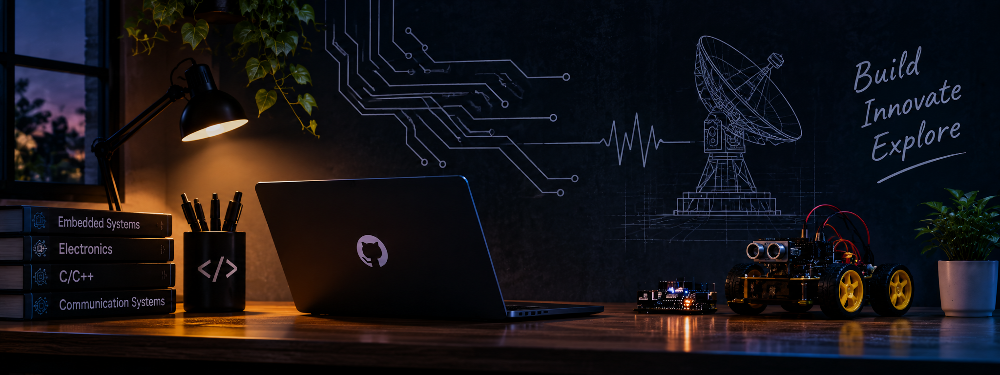

 

# ONKAR GHODECHOR

### Electronics & Telecommunication Engineering Student

*Interested in electronics, programming, and building practical technology.*

---

## About Me

I'm an Electronics and Telecommunication Engineering student interested in understanding how hardware and software work together.

I enjoy learning new technologies, experimenting with code, and developing projects that help me improve my practical engineering skills.

- Currently learning **C and C++**
- Exploring **Embedded Systems and IoT**
- Building my foundation in **Programming and Problem Solving**
- Learning **Git and GitHub** for project development and collaboration
- Interested in **Electronics, Communication Systems and Technology**

---

## Technical Skills

| Category | Technologies |
|:---|:---|
| Programming | C, C++ |
| Version Control | Git, GitHub |
| Code Editor | Visual Studio Code |
| Interests | Embedded Systems, IoT, Digital Electronics |
| Engineering | Electronics & Telecommunication |

### Tools & Technologies

---

## Projects & Experiments

I use GitHub to document my learning journey and share practical work.

Some areas I'm exploring:

- **C/C++ Programming:** Small programs and programming fundamentals.
- **Electronics:** Basic electronic concepts and circuit-related experiments.
- **Embedded Systems:** Understanding microcontrollers and hardware-software integration.
- **IoT:** Exploring connected devices and communication technologies.

<b>What I want to build next</b>

- Microcontroller-based projects
- Sensor-based monitoring systems
- Basic automation projects
- Electronics simulations

---

## GitHub Statistics

---

## Current Goals

- Strengthen programming fundamentals.
- Improve problem-solving skills.
- Develop practical electronics projects.
- Learn embedded systems and IoT.
- Build a meaningful engineering portfolio.

---

## Connect With Me

**Open to learning, collaboration, and interesting engineering projects.**

---

*Learning steadily. Building things. Improving with every project.*

